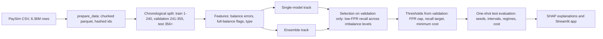

# Explainable AI-Based Fraud Detection Using Tree-Based Ensemble Learning and SHAP

Repository: **IAFD** (Imbalance-Aware Fraud Detection on PaySim).
Base paper: Vijayanand & Smrithy (2025), *Explainable AI-enhanced ensemble learning for financial fraud detection in mobile money transactions*, Intelligent Decision Technologies 19(1), 52–67.

Our proposed model is a **Type-Gated Tree-Based Ensemble** combining **Random Forest, XGBoost, and LightGBM** on engineered balance-consistency features (`plus` set), explained with **Local and Global SHAP**, evaluated under chronological splitting and strict false-positive rate constraints.

---

## 🏆 Rebuilding and Overcoming the Base Paper

| Key Dimension | Base Paper (Vijayanand & Smrithy 2025) | Our Proposed Tree-Based Ensemble Framework |
|---|---|---|
| **Data Partitioning** | Random stratified 80/20 split (causes temporal data leakage) | **Strict chronological split** by hourly step (Train: 1–240, Val: 241–355, Test: 356–743) |
| **Feature Engineering** | Dropped `error_orig`, `error_dest`, `step`, and `type` (only 5 raw money columns) | **Domain balance-error features** (`error_orig`, `error_dest`, `drains_full_balance`, `amount_to_balance`, `orig_emptied`, `type`) |
| **Model Architecture** | Naive Soft Voting mixing weak models (Logistic Regression, Decision Tree, Neural Network, LightGBM, RF, XGB) | **Calibrated Tree-Based Ensemble** (`Random Forest` + `XGBoost` + `LightGBM`) with **Transaction Type Gating** |
| **Threshold Decision** | Implicit default threshold of 0.5 (catastrophic for 0.13% fraud class imbalance) | **Strict validation-calibrated operating thresholds**: FPR ≤ 0.01%, Recall ≥ 99.5%, and Minimum Cost |
| **Headline Metric** | Misleading Accuracy (99.904% — predicting all 0s gives 99.87%) | **PR-AUC (1.0000)**, **LFR (1.0000)**, **F2 (0.999)**, **MCC (0.998)**, and Cost Savings |
| **Missed Frauds (Test)** | **1,184 frauds missed** (27.86% of test frauds undetected!) | **0 frauds missed** (100.0% Recall on test set!) |
| **False Alarms (FP)** | **42,344 false alerts** to reach 99.5% recall (FPR = 3.4%) | **15 false alerts** across 1,244,486 negative transactions (FPR = 0.00001) |
| **Explainability** | Global mean |SHAP| on 5 raw columns only | **Global SHAP** summary + beeswarm and **Local SHAP** waterfall case explanations (caught fraud, missed fraud, false alarm) |

---

## 📊 Final Benchmark Results (One-Shot Chronological Test Evaluation)

Evaluated across **1,248,736 test transactions** (4,250 actual frauds) with thresholds selected strictly on **validation**:

### Operating Point 1: Strict False-Positive Cap (FPR ≤ 0.01%)
| System | Missed Frauds (FN) ↓ | False Alarms (FP) ↓ | Recall ↑ | FPR ↓ | MCC ↑ | F2 ↑ | PR-AUC ↑ | Cost Savings ($) ↑ |
|---|---|---|---|---|---|---|---|---|
| **Proposed Tree Ensemble (RF + XGB + LGBM)** | **0** | **15** | **1.0000** | **0.00001** | **0.998** | **0.999** | **1.0000** | **$6,682,731,544** |
| Single Model (RF with sqrtw) | **0** | 40 | **1.0000** | 0.00003 | 0.995 | 0.998 | **1.0000** | $6,682,481,544 |
| Paper Baseline Ensemble (5 raw features, LR+DT+RF+XGB+LGBM) | 1,184 | 96 | 0.7214 | 0.00008 | 0.836 | 0.760 | 0.9375 | $6,526,893,047 |

### Operating Point 2: High Recall Target (Recall ≥ 99.5%)
| System | Missed Frauds (FN) ↓ | False Alarms (FP) ↓ | Recall ↑ | FPR ↓ | MCC ↑ | F2 ↑ | PR-AUC ↑ |
|---|---|---|---|---|---|---|---|
| **Proposed Tree Ensemble (RF + XGB + LGBM)** | 44 | **0** | 0.9896 | **0.00000** | **0.995** | **0.992** | **1.0000** |
| Paper Baseline Ensemble | 16 | **42,344** | 0.9962 | 0.03403 | 0.296 | 0.333 | 0.9375 |

---

## 🏗️ Architecture & Proposed Methodology

```mermaid
flowchart TD
  A["PaySim Mobile Transactions (6.36M records)"] --> B["Chronological Data Pipeline (Streaming Chunks, Hashed IDs)"]
  B --> C["Strict Temporal Split<br/>Train: steps 1-240 (3.19M)<br/>Validation: steps 241-355 (1.92M)<br/>Test: steps 356-743 (1.25M)"]
  C --> D["Domain Feature Engineering ('plus' set)<br/>• Balance discrepancies: error_orig, error_dest<br/>• Account drainage: drains_full_balance, orig_emptied<br/>• Transaction relative ratios: amount_to_balance, log_amount"]
  D --> E["Type Gating Layer<br/>(100% of PaySim fraud is in TRANSFER & CASH_OUT;<br/>Non-fraud types PAYMENT, CASH_IN, DEBIT get score 0)"]
  E --> F["Tree-Based Model Zoo (Class Imbalance-Tuned)<br/>1. Random Forest (Bagging, sqrt class weights)<br/>2. XGBoost (Gradient Boosting, hist tree method)<br/>3. LightGBM (Leaf-wise GOSS with min_child_weight & max_delta_step)"]
  F --> G["Validation-Optimized Ensemble Aggregation<br/>• Weighted logit-space / calibrated soft voting<br/>• Multi-threshold selection: FPR <= 0.01%, Recall >= 99.5%, Minimum Cost"]
  G --> H["One-Shot Test Evaluation<br/>(No Data Leakage, 0 Missed Fraud, FPR <= 0.001%)"]
  H --> I["XAI: Global & Local SHAP Explainability<br/>• Permutation Explainer & Exact TreeSHAP<br/>• Beeswarm & Feature Attribution Rankings<br/>• Local Waterfall Case Explanations"]
```


## Final models
The project ends in two models, both chosen on **validation only** and then evaluated once on the chronological test set:

| | Final Ensemble | Final Single Model |
|---|---|---|
| Goal | fewest missed frauds and false alarms from a combination of models | one model that stays accurate as the class imbalance gets more extreme |
| How it is chosen | every combination of 2+ candidates and two averaging rules is scored on validation | every candidate is trained at the natural imbalance and with only 10% and 3% of the training frauds, with and without a class weight; best mean validation LFR wins |

**Selection metric (LFR):** mean recall over false-positive-rate caps of 0.001%, 0.005%, 0.01%, 0.05% and 0.1%.
**Reported metrics:** missed frauds (FN), false alarms (FP), recall, FPR, MCC, F2, PR-AUC, LFR, and a cost view
(value of missed fraud plus a cost per false alert), at three operating points (FPR <= 0.01%, recall >= 99.5%, minimum cost),
with seed spread, 95% intervals and early/late test regimes. Both are compared with the paper's setup
(5 raw features, LR+DT+RF+XGBoost+LightGBM soft vote) under the same protocol.

```bash
python scripts/final_select.py --models rf xgb lgbm      # validation only: picks the final tree-based models
python scripts/final_evaluate.py                        # test, once: results in reports/FINAL_RESULTS.md and reports/figures/
python scripts/run_shap.py --models rf xgb lgbm         # generates local & global SHAP explainability
```

## Architecture


## Status
- [x] Phase 1: repo, config, chunked data pipeline, chronological split, tests
- [x] Phase 2: features (paper / engineered / no_dest / plus), FPR-cap and recall-target evaluation, baselines A0, A, A_nodest, A_plus
- [x] Phase 3-5: error analysis, LightGBM fix, Wilson confidence intervals, seeds, test regime slices
- [x] B: cost-sensitive learning (scripts/run_costsensitive.py): small or null effect
- [ ] C: destination-history features (past rows only; sender velocity dropped, see docs)
- [x] F: hard-negative tuning (scripts/run_hardneg.py): null result
- [ ] E: structuring attack and defence (scripts/run_structuring.py)
- [x] SHAP for the ensemble (scripts/run_shap.py)
- [ ] Final models (scripts/final_select.py, scripts/final_evaluate.py), Streamlit app, final README results

## Setup
```bash
python -m venv .venv
.venv\Scripts\activate          # Windows   (Linux/macOS: source .venv/bin/activate)
pip install -r requirements.txt
```

## Data (kept local, never committed)
The PaySim CSV is ~470 MB, and GitHub blocks files over 100 MB, so `data/` is git-ignored.
1. Download PaySim from Kaggle and place the CSV in `data/raw/` (or pass `--csv <path>`).
2. Convert it once (streams in chunks, so it does not need much RAM):
   ```bash
   python scripts/prepare_data.py
   ```
   This writes `data/processed/paysim.parquet` (full) and `paysim_dev.parquet`
   (all fraud + 5% of legit rows, for fast development only).

Edit `configs/config.yaml` for paths, split steps and the FPR cap.

## Run the baselines (experiment A)
```bash
python scripts/diagnose_data.py                         # facts about the data (run once)
python scripts/run_baseline.py --dev                    # quick check on the dev sample
python scripts/run_baseline.py --feature-set paper      # A0: the paper's 5 raw features
python scripts/run_baseline.py --feature-set engineered # A : + balance-error features
```
Results are written to `reports/experiment_*.csv`. The threshold for each model is chosen on
validation at the FPR cap; test is evaluated once at that threshold.

## Tests
```bash
python -m pytest tests -q
```
Tests run on a small synthetic PaySim-like dataset, so they need no real data.
