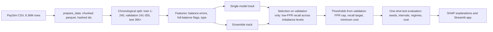

# Explainable AI-Based Fraud Detection Using Ensemble Learning and SHAP

Repository: IAFD (Imbalance-Aware Fraud Detection on PaySim). The model is a soft-voting ensemble (LR, RF, XGBoost, LightGBM) explained with SHAP; the evaluation is chronological and false-positive-capped.

Explainable, imbalance-aware fraud detection on the PaySim mobile-money dataset.
Base paper: Vijayanand & Smrithy (2025), *Explainable AI-enhanced ensemble learning for financial
fraud detection in mobile money transactions*, Intelligent Decision Technologies 19(1), 52-67.

## What this rebuild changes versus the paper
| Paper | This project |
|---|---|
| Random stratified 80/20 split | Chronological split by `step` (no future leakage) |
| Accuracy as the headline (99.9%) | PR-AUC, recall at a fixed false-positive cap, cost |
| Threshold implicitly 0.5 | Threshold chosen on validation only, under an FPR cap |
| Global SHAP on 5 raw columns | Local + global SHAP on engineered features |

## Final models
The project ends in two models, both chosen on **validation only** and then evaluated once on the chronological test set:

| | Final Ensemble | Final Single Model |
|---|---|---|
| Goal | fewest missed frauds and false alarms from a combination of models | one model that stays accurate as the class imbalance gets more extreme |
| How it is chosen | every combination of 2+ candidates and two averaging rules is scored on validation | every candidate is trained at the natural imbalance and with only 10% and 3% of the training frauds, with and without a class weight; best mean validation LFR wins |

**Selection metric (LFR):** mean recall over false-positive-rate caps of 0.001%, 0.005%, 0.01%, 0.05% and 0.1%.
**Reported metrics:** missed frauds (FN), false alarms (FP), recall, FPR, MCC, F2, PR-AUC, LFR, and a cost view
(value of missed fraud plus a cost per false alert), at three operating points (FPR <= 0.01%, recall >= 99.5%, minimum cost),
with seed spread, 95% intervals and early/late test regimes. Both are compared with the paper's setup
(5 raw features, LR+DT+RF+XGBoost+LightGBM soft vote) under the same protocol.

```bash
python scripts/final_select.py      # validation only: picks the two final models
python scripts/final_evaluate.py    # test, once: results in reports/FINAL_RESULTS.md and reports/figures/
```

## Architecture


## Status
- [x] Phase 1: repo, config, chunked data pipeline, chronological split, tests
- [x] Phase 2: features (paper / engineered / no_dest / plus), FPR-cap and recall-target evaluation, baselines A0, A, A_nodest, A_plus
- [x] Phase 3-5: error analysis, LightGBM fix, Wilson confidence intervals, seeds, test regime slices
- [x] B: cost-sensitive learning (scripts/run_costsensitive.py): small or null effect
- [ ] C: destination-history features (past rows only; sender velocity dropped, see docs)
- [x] F: hard-negative tuning (scripts/run_hardneg.py): null result
- [ ] E: structuring attack and defence (scripts/run_structuring.py)
- [x] SHAP for the ensemble (scripts/run_shap.py)
- [ ] Final models (scripts/final_select.py, scripts/final_evaluate.py), Streamlit app, final README results

## Setup
```bash
python -m venv .venv
.venv\Scripts\activate          # Windows   (Linux/macOS: source .venv/bin/activate)
pip install -r requirements.txt
```

## Data (kept local, never committed)
The PaySim CSV is ~470 MB, and GitHub blocks files over 100 MB, so `data/` is git-ignored.
1. Download PaySim from Kaggle and place the CSV in `data/raw/` (or pass `--csv <path>`).
2. Convert it once (streams in chunks, so it does not need much RAM):
   ```bash
   python scripts/prepare_data.py
   ```
   This writes `data/processed/paysim.parquet` (full) and `paysim_dev.parquet`
   (all fraud + 5% of legit rows, for fast development only).

Edit `configs/config.yaml` for paths, split steps and the FPR cap.

## Run the baselines (experiment A)
```bash
python scripts/diagnose_data.py                         # facts about the data (run once)
python scripts/run_baseline.py --dev                    # quick check on the dev sample
python scripts/run_baseline.py --feature-set paper      # A0: the paper's 5 raw features
python scripts/run_baseline.py --feature-set engineered # A : + balance-error features
```
Results are written to `reports/experiment_*.csv`. The threshold for each model is chosen on
validation at the FPR cap; test is evaluated once at that threshold.

## Tests
```bash
python -m pytest tests -q
```
Tests run on a small synthetic PaySim-like dataset, so they need no real data.
